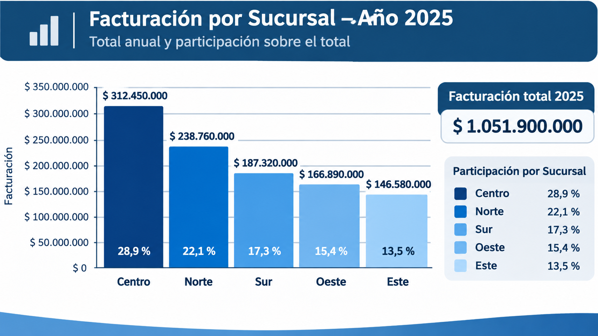

# Análisis Comercial de Ventas 
## Descripción 
Este proyecto presenta un ejemplo de análisis comercial orientado a estudiar el 
desempeño de ventas de una empresa con distintas sucursales. 
El objetivo principal es mostrar cómo puede organizarse y documentarse un proyecto de 
análisis de datos para incorporarlo a un portfolio profesional. --- 
## Índice 
1. [Objetivo](#objetivo) 
2. [Datos utilizados](#datos-utilizados) 
3. [Herramientas](#herramientas) 
4. [Metodología](#metodología) 
5. [Resultados](#resultados) 
6. [Estructura del proyecto](#estructura-del-proyecto) 
7. [Autor](#autor) --- 
## Objetivo 
Analizar información comercial para comparar el desempeño de distintas sucursales e 
identificar patrones relevantes de facturación. --- 
## Datos utilizados 
El proyecto utiliza un conjunto de datos de ejemplo con información sobre operaciones 
comerciales. 
Entre las variables disponibles podemos encontrar: - fecha de la operación; - sucursal; - producto; - cantidad; - precio unitario. 
Los archivos utilizados para el análisis se almacenan dentro de la carpeta: 
`data/` --- 
## Herramientas 
Para el desarrollo del proyecto pueden utilizarse distintas herramientas aprendidas 
durante el curso: - Excel; - SQL; - Python; - Pandas; - Power BI; - Git; - GitHub. --- 
## Metodología 
El procedimiento general del análisis comprende: 
1. revisión inicial de los datos; 
2. identificación de problemas de calidad; 
3. limpieza y transformación; 
4. cálculo de indicadores; 
5. análisis de resultados; 
6. construcción de visualizaciones; 
7. elaboración de conclusiones. --- 
## Resultados 
A modo de ejemplo, un análisis de este tipo podría permitir estudiar: - facturación total; - facturación por sucursal; - productos con mayores ingresos; - evolución mensual de las ventas; - diferencias de desempeño entre sucursales. 
### Ejemplo de visualización 
 --- 
## Acceso a resultados externos 
También podemos incorporar enlaces hacia otros recursos. 
Por ejemplo: 
[Ver dashboard del proyecto](https://ejemplo.com) 
En un proyecto real deberíamos reemplazar este enlace por la dirección correspondiente 
a nuestro dashboard. --- 
## Estructura del proyecto 
El repositorio se organiza de la siguiente manera: 
```text 
analisis-comercial/ 
│ 
├── README.md 
│ 
├── img/ 
│  
 └── resultado.png 
│ 
├── data/ 
│  
 └── README.md 
│ 
└── analisis/ 
├── README.md 
└── analisis.ipynb 
Cada carpeta contiene un tipo diferente de recurso. 
La carpeta data contiene los datos utilizados. 
La carpeta analisis contiene los archivos empleados para desarrollar el análisis. 
La carpeta img almacena imágenes utilizadas para presentar los resultados. 
```
## Autor
Proyecto desarrollado como práctica del curso de Análisis de Datos. 
Nombre del alumno: Nombre Apellido


[GitHub](http://www.github.com/)